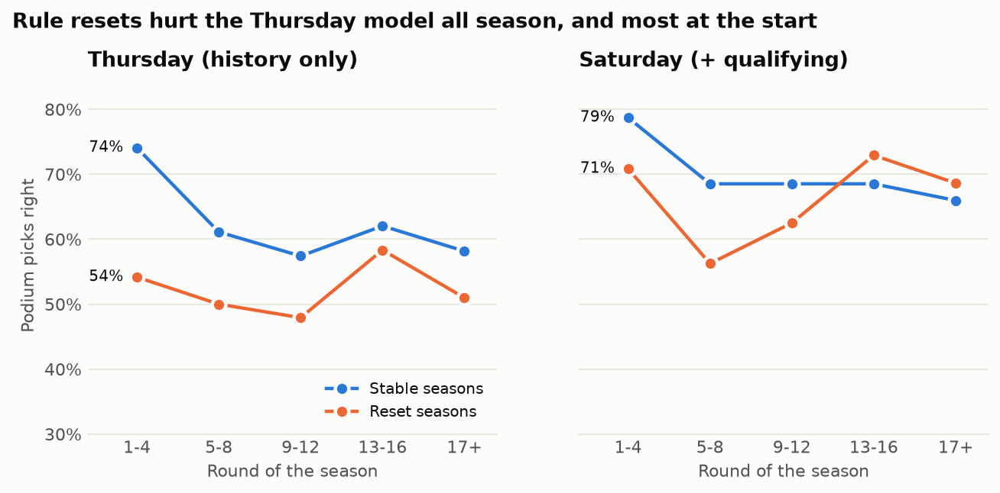
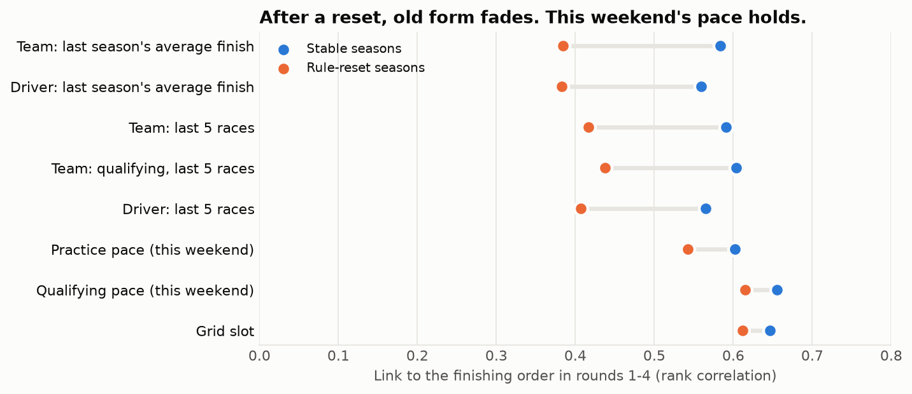
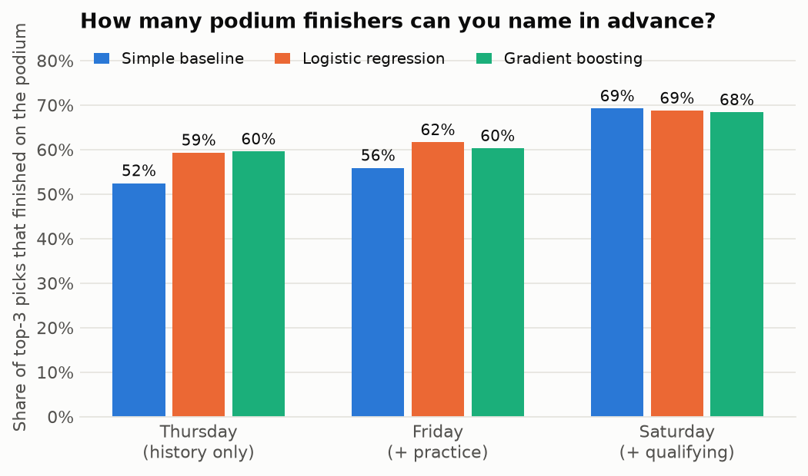
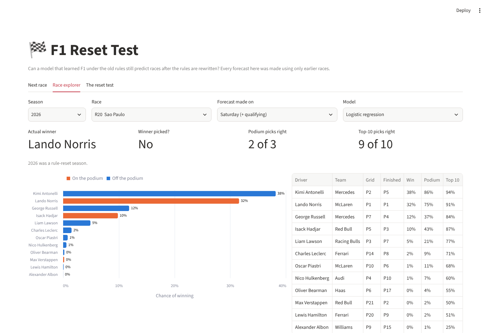

# 🏁 F1 Reset Test

**Can a model that learned F1 under the old rules still predict races after the rules are rewritten?**

2026 brought new cars and new engines. This project trains race-prediction models on past seasons, then checks what happens to them in rule-reset seasons (2014, 2017, 2022, 2026) compared with normal ones.

For every driver in every race it predicts three things: the chance of **winning**, finishing on the **podium**, and finishing in the **top 10**. It makes each forecast three times, with what you would know on that day:

| Day | What the model knows |
|---|---|
| Thursday | History only: driver form, team form, reliability, track record |
| Friday | + practice pace |
| Saturday | + qualifying (grid slot, gap to pole) |

## What it found

Numbers are from 272 test races, 2014 to round 20 of 2026. Every forecast used a model that had only seen earlier races. Full tables: [`outputs/findings.md`](outputs/findings.md).

**1. A rule reset hurts, and it hurts most at the start.**
In the first four races of a normal season the Thursday model gets 74% of its podium picks right. After a reset that drops to 54% (gap of 20 points, 90% interval 10 to 29). From round 5 onwards the gap shrinks to 8 points but does not fully close.



**2. Qualifying rescues the model.**
Once the grid is known, the reset gap in the opening rounds shrinks to 8 points (79% vs 71%), and that gap is within the noise.

**3. Old form fades, this weekend's pace holds.**
In rounds 1 to 4, last season's team form orders the field well in normal years (rank correlation 0.58) and much worse after a reset (0.38). Grid slot barely moves (0.65 vs 0.61).



**4. Machine learning helps before qualifying, not much after.**
On Thursday the logistic model picks 45% of winners; "whoever has been finishing best lately" picks 37%. On Saturday, plain grid order picks 55% of winners and the models do not clearly beat it on picks (50% and 56%). They do give better probabilities (log loss 0.101 vs 0.112).



**5. Retraining after every race barely changes the picks.**
It improves the probabilities slightly (podium log loss 0.253 to 0.247 for the Thursday model in reset seasons). The rolling form features already do most of the adapting.

**6. 2026 is the hardest season in the test.**
The Thursday model gets 43% of podium picks right in 2026, the lowest of all 13 seasons.

## Run it

Needs Python 3.10+ and git.

```bash
pip install -r requirements.txt
streamlit run app.py          # the app works straight away with the included results
python run_all.py             # refresh everything after a race weekend (5 to 10 minutes)
```

The app has three tabs: a forecast for the next race, a race explorer (pick any race since 2014 and compare the forecast with what happened), and the reset-test results.



A GitHub Action re-runs the whole pipeline every Tuesday and commits the new results when a race has been added to the data.

## How it works

| File | Job |
|---|---|
| `src/00_get_data.py` | Downloads the open F1 database |
| `src/01_build_dataset.py` | Turns the raw files into one table: one row per driver per race |
| `src/02_features.py` | Builds the model inputs, using only information from before each race |
| `src/models.py` | The baselines, the two models, and the scoring functions |
| `src/03_predict.py` | Walk-forward testing: train on the past, predict the next season or race |
| `src/04_analysis.py` | Answers the research questions, writes the tables and charts |
| `app.py` | The Streamlit app |
| `src/common.py` | Settings: seasons, reset years, team name changes |

**Models.** Logistic regression and gradient boosting (scikit-learn), compared against three no-ML baselines: recent form (Thursday), practice order (Friday), grid order (Saturday).

**Testing.** Two modes. *Frozen*: train on every season before the test season, then predict that whole season. *Updating*: retrain before every race, weighting recent races more.

**Scoring.** Winner picked (yes/no), share of top-3 picks that reached the podium, share of top-10 picks that finished top 10, and log loss for the probabilities.

## Limits

- Only four reset seasons are in the test set, so the opening-rounds comparison rests on 16 races. The intervals above show how wide the uncertainty is.
- No weather data and no lap-by-lap data, so no wet-race feature and no live in-race win probability yet.
- A driver who does not finish counts as finishing last when form is calculated.
- Qualifying pace is each driver's best lap of the whole session, so a wet Q3 can make it differ from the grid order.
- The next-race forecast assumes the same driver line-up as the previous race.

## Ideas for later

- Live win probability during a race, using lap data from FastF1 or OpenF1.
- A weather feature.
- A fresh look once the 2026 season is complete (three races to go at the time of writing).

## Data and licence

Data: [F1DB](https://github.com/f1db/f1db), an open F1 database, licensed CC BY 4.0. Seasons 2006 to 2026.
Code: MIT licence.
